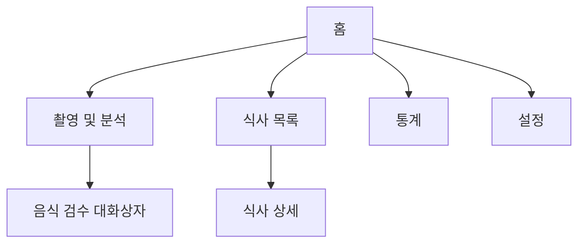

# 화면 설계

## 탐색

`GoRouter`로 `/`, `/capture`, `/meals`, `/stats`, `/settings`를 연결하며 상세는 목록에서 화면 전환한다.

## 주요 상호작용
1. 촬영 화면에서 사진을 선택하고 외부 전송을 동의한다.
2. AI 결과가 유효한 bbox를 포함할 경우 음식 번호·이름을 이미지 위에 표시한다.
3. 박스 또는 음식 목록을 누르면 동일한 인덱스를 선택한다. 목록에서 검수 대화상자를 연다.
4. 이름·중량·100g당 열량을 수정하고 저장한다.
5. 기록 조회·통계는 네트워크 없이 로컬 DB에서 수행한다.

## 제약 및 다음 개선
여러 사진 병합, 실제 이미지 비율을 유지한 `BoxFit.contain` 좌표 매핑, 박스 수동 이동·분할·병합, 결과 undo/redo, 알림 및 접근성은 아직 미완료다.
