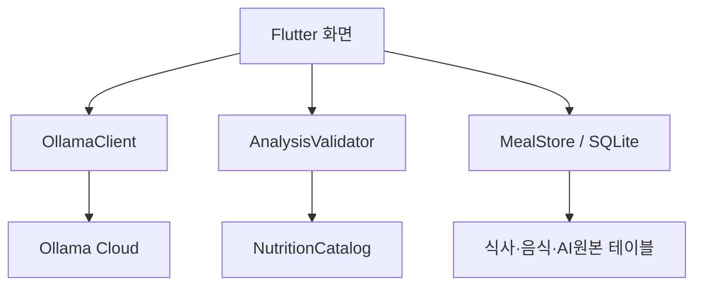

# 시스템 아키텍처

## 모듈
- `lib/domain/food.dart`: 음식 모델, 응답 검사, 합계.
- `lib/domain/nutrition.dart`: 검증 가능한 영양자료 로더와 음식명 후보 검색.
- `lib/data/ollama_client.dart`: 이미지 업로드, 인증, 응답 처리.
- `lib/data/meal_store.dart`: 테이블 생성과 트랜잭션.
- `lib/ui/food_overlay.dart`: 정규화 박스 렌더링.
- `lib/ui/meal_pages.dart`: 목록, 상세, 통계.

## 위험
직접 호출은 사용자 API 키를 요구하므로 서비스 배포에서는 백엔드 중계 계층이 필수다. 앱 데이터는 기기별이며 기기간 동기화·백업은 아직 없다.
